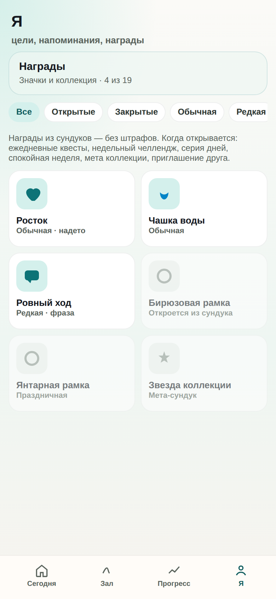
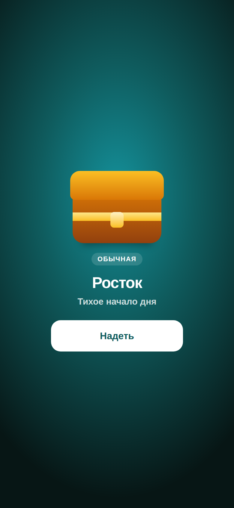
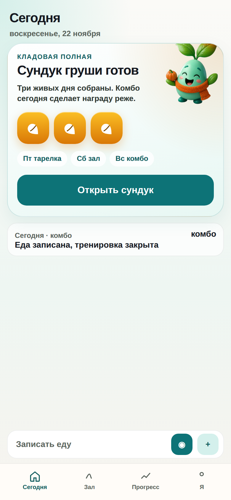
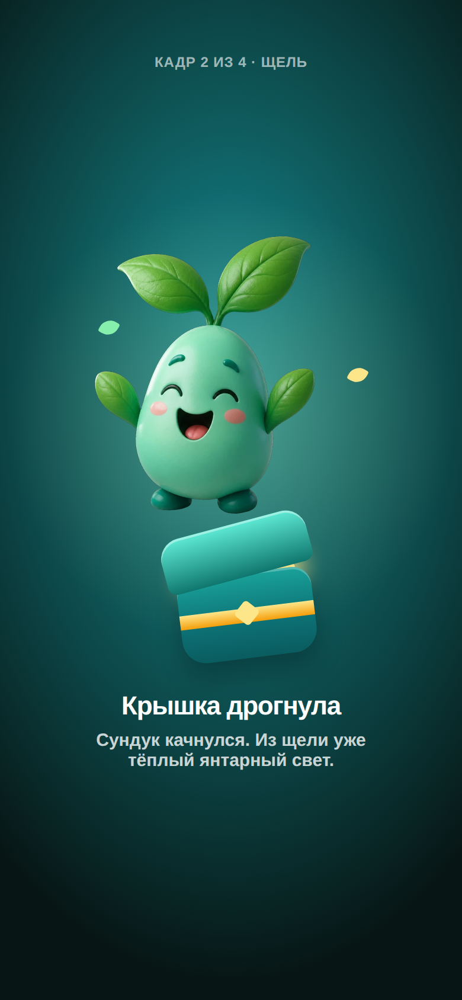
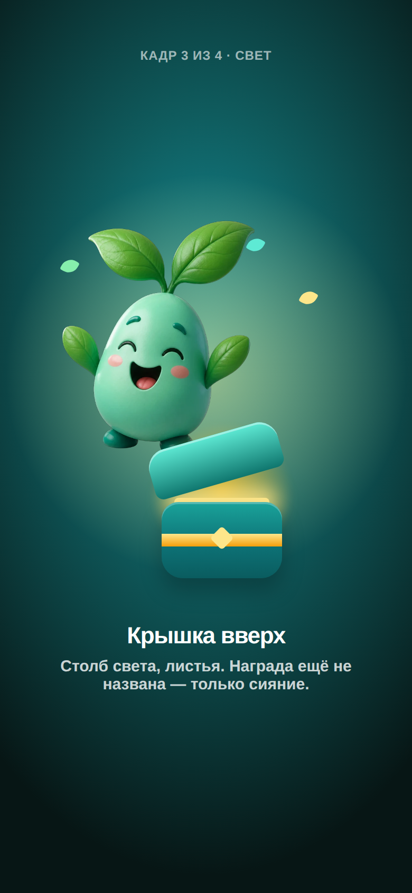
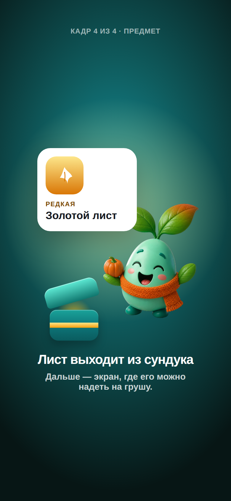
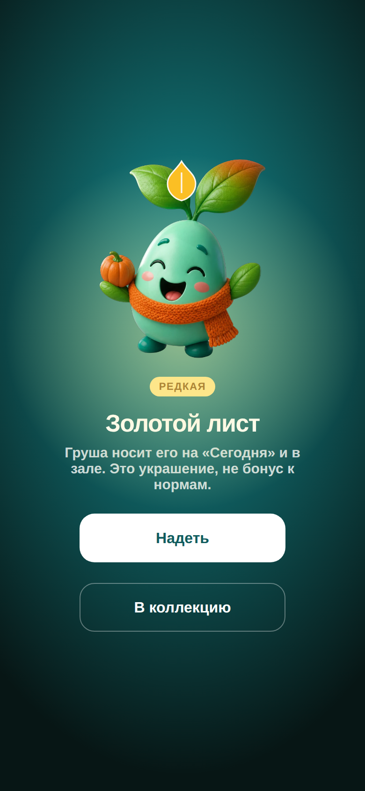
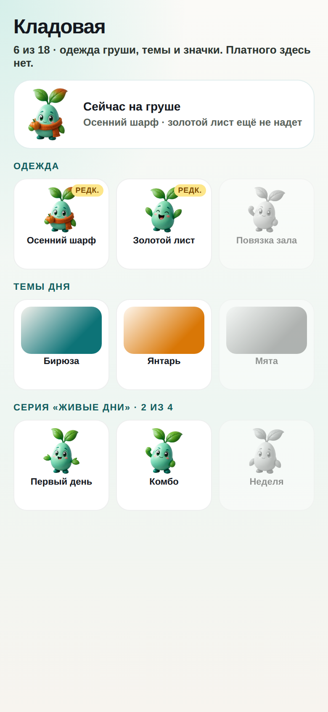
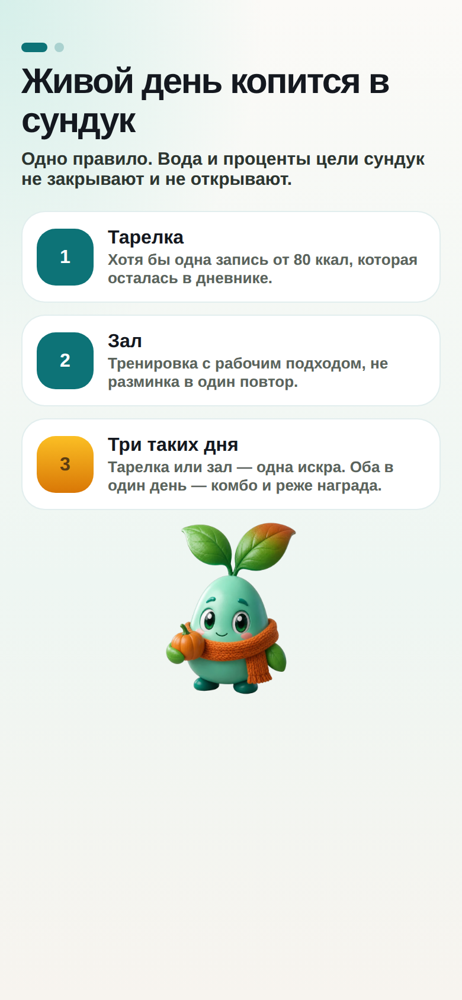

# Сундуки: как есть и как переделать

Концепция, без изменений в продукте. Отзыв Игоря, который пользуется приложением каждый день: механика непонятна, её не видно, вид не хочется открывать. Нужно переделать целиком — ярко, красиво и так, чтобы хотелось вести дневник и ходить в зал.

Рекомендация коротко: одно правило «живой день», одна шкала из трёх листьев на первом экране «Сегодня», открытие с грушей и сундуком, награды только косметические. Ниже — почему сейчас не работает, два запасных варианта и этапы, когда дойдёт до кода.

Макеты нарисованы в ширину 390 CSS-пикселей, в цветах приложения (сливки `#f5f3ee`, бирюза `#0d7377`, янтарь `#d97706`), шрифтами Manrope и Unbounded, с живой грушей из `public/mascot`. Снимки сняты в 2×, поэтому файл 780×1688. Это зарисовки экранов, не сборка приложения: в этой среде нет MySQL, поэтому демо-день (приёмы, вода, зал, готовый сундук) собран в статике по текстам и вёрстке живых компонентов.

## Как это устроено сейчас

С точки зрения человека правило звучит так, и каждый кусок звучит по-своему.

На «Сегодня» под лентой приёмов лежит узкая карточка «Сундук». В пустой день она пишет: «Еда + вода или тренировка · 3 дня». Если день уже копится: «Ещё N дней до сундука» и полоска высотой 6 пикселей. Один раз показывается абзац: спокойный день — это запись еды и норма воды, три таких дня дают наклейку, фразу или рамку. Рядом может висеть «мета 2/5». Когда шкала заполнена, появляется кнопка «Открыть» и иногда «ещё в очереди».

Квесты, которые этот день вообще отмечают, спрятаны в свёрнутом блоке «Ещё на сегодня»: записать приём, дойти по воде, тренировка с пометкой «в сундук». Если еда и вода закрыты, полоска пишет «ещё N лёгких дней», даже когда кнопка «Открыть» уже есть выше.

В зале сундук не открывается. Если он готов, на экране тренировки есть ссылка «Сундук готов · рацион». После сессии отдельным абзацем: тренировка даёт один зачёт на день, а комбо с белком — тот же один зачёт, не второй. Шкалы в зале нет.

Награды лежат в «Я», в секции «Награды», ниже целей и напоминаний, рядом со значками. Это мелкие картинки: наклейка, фраза маскота, рамка аватара. Редкость — обычная, редкая, праздничная. Открытие, если его не приглушили, — тёмный бирюзовый экран и янтарный сундук без груши, затем название вещи и «Надеть».

На Android отдельного экрана нет. Приложение — то же веб-окно в оболочке Capacitor. Если связи нет, на карточке появляется «Открытие в очереди — уйдёт при связи», а на иконке — общее уведомление про черновики (еда, вода, зал, AI и сундук в одной куче).

### Что делает сервер

Один счётчик. Каждые три «зачёта» (`rewardKey = quest_day`) дают один сундук `quest-chest:N`. Зачёт пишется строкой `UserReward`, одна строка на ключ источника.

Зачёт еды и воды — ключ `quest-day:ДАТА`. Он ставится, только если в этот день есть хотя бы одна запись еды и вода дошла до личной нормы. Настроение с версии, где выключили старый ускоритель, зачёт не даёт. Старые строки `quest-day-boost:` в базе остаются.

Зачёт зала — другой ключ, `gym-chest:ДАТА:session:ID`, но это тоже `quest_day`. Его даёт завершённая тренировка с рабочим подходом: не разминка и есть повторы, дистанция или время. Один такой зачёт на календарный день. Комбо «тренировка + белок в цели» вид зачёта не удваивает. Зал ставится сам, когда сохраняется подход или приём пищи, и не ждёт норму воды.

Итог, которого не видно в текстах: еда с водой и тренировка в один день — это две отметки на шкале из трёх. Подпись говорит «или» и «день идёт один раз». Счётчик молча складывает.

Поверх шкалы в ту же кнопку «Открыть» встаёт очередь, по порядку: дневной сундук, потом серия (7, 14, 30, 60, 100, 200, 365), спокойная неделя (все дни с записи с понедельника, если их уже пять или больше), закрытый недельный челлендж, приглашение друга. Мета-сундук (5, 10, 15 вещей или собранная группа) не открывается этим экраном: он падает тихим уведомлением.

Награда выбирается из каталога в `src/lib/rewards.ts`: наклейки, фразы, рамки. Уже полученное не повторяется, пока каталог не кончится. Каждый четвёртый сундук без редкой вещи форсирует редкую или праздничную. Платных бонусов нет и сейчас.

Пока нет сети, запрос «отметить день» или «открыть» лежит в `localStorage` и уходит позже. Сервер всё равно проверяет условия. Клиент сам награду не выдаёт.

### Где это в интерфейсе

| Место | Что видит человек |
| --- | --- |
| «Сегодня», первый экран | Герой калорий, лента приёмов. Сундука нет: его убрали под ленту, чтобы не закрывать еду |
| «Сегодня», если прокрутить | Карточка `ChestDock`: подпись, полоска 6 px, иногда кнопка «Открыть» |
| Вечер в том же герое | Текст вроде «ещё N спокойных дней» или «Открыть сундук», и только если сервер уже сказал, что сундук готов |
| «Ещё на сегодня» | Квесты. Сами сундук не открывают, только отмечают день |
| Зал | Ссылка увести на рацион и абзац «Зачёт сундука» |
| «Я» → Награды | Коллекция и список из шести причин, когда сундук открывается |
| Android | То же окно плюс офлайн-очередь и общий бейдж черновиков |

Груша на герое дня есть. К сундуку она не привязана: иконка сундука — плоский бирюзовый чертёж 36×36, на церемонии — янтарный ящик без маскота.

## Почему это непонятно и незаметно

Правило не одно. Док говорит «еда и вода или тренировка». Подсказка говорит «еда и вода, три дня». Квест говорит, что комбо идёт в сундук один раз. Зал говорит, что белок не даёт второй зачёт. Сервер в один день может положить и `quest-day`, и `gym-chest`. Человек, который и так каждый день в приложении, не может ответить на вопрос «за что мне следующий сундук».

Шкала не на первом экране. Волна вёрстки специально опустила сундук под дневник. Пока на экране калории и приёмы, механики нет. Полоска в 6 пикселей и чертёж сундука не спорят с грушей.

Вода — скрытые ворота дневного зачёта. Запись еды без полной нормы воды день не закрывает, хотя подпись про тренировку обещает обходной путь. Вода при этом живёт своим трекером и своими значками.

Награда не про грушу. Наклейка, фраза и рамка аватара лежат глубоко в профиле. На «Сегодня» и в зале надетое почти не читается. Открытие можно приглушить, и тогда вместо сцены остаётся тихая карточка.

Слов «мета», «очередь», «спокойный день» в интерфейсе больше, чем одного ясного предложения.

Зал не празднует. Готовая тренировка не показывает, как близко сундук. Она либо молчит, либо отправляет назад на рацион.

### Сейчас, демо-день

Первый экран. Сундук ниже сгиба.

Та же дата, если прокрутить ленту. Полоска, «мета 2/5» и абзац правил.

Когда шкала заполнена: кнопка «Открыть», «ещё в очереди», а квесты внутри «Ещё» говорят про «лёгкие дни».

Зал: ссылка на рацион и абзац про зачёт. Открыть здесь нельзя.

Коллекция в профиле: мелкие карточки и шесть разных причин открытия.

Церемония сейчас: ящик без груши.

Android: то же окно. Уведомление — про черновик на устройстве, не про сундук. Строка на карточке — «открытие в очереди».

## Три варианта

### А. Две шкалы

Отдельная шкала «Тарелка» (три записи еды) и отдельная «Зал» (две настоящие тренировки). Два разных сундука.

Плюс: сразу видно, зачем идти в зал, даже если дневник уже ведётся. Плюс: правило каждой шкалы короткое.

Минус: на «Сегодня» две полоски рядом с калориями. Минус: кто не ходит в зал, постоянно видит пустую шкалу. Минус: снова два сундука и снова вопрос, какой открывать.

### Б. Живой день — этот и стоит делать

Одна шкала из трёх листьев на карточке груши, в первом экране «Сегодня».

Живой день — один на календарные сутки. Он есть, если есть тарелка или зал. Тарелка — хотя бы одна запись от 80 ккал, которая осталась в дневнике. Зал — завершённая тренировка с рабочим подходом, не разминка. Три живых дня — сундук. Если в один день есть и еда, и зал, искра всё равно одна, но этот день помечается комбо: ближайший сундук на ступень реже.

Вода, процент калорий и настроение сундук не двигают. Они остаются в трекере, в герое дня и в значках.

Плюс: одно предложение, которое можно прочитать на карточке. Плюс: и дневник, и зал двигают одну цель, пропуск дня шкалу не обнуляет. Плюс: комбо — причина сходить в зал в день, когда еда уже записана, без второй полоски.

Минус: в зал по-прежнему не обязаны. Кто ведёт только дневник, сундуки получает. Зал повышает редкость, а не открывает отдельную коробку. Это сознательный обмен: одна понятная шкала важнее второй обязательной.

### В. Только серия

Сундук за три живых дня подряд. Пропуск обнуляет.

Плюс: огонь серии очень заметен, груша «просит не бросать».

Минус: тон приложения — без штрафа и без давления. Обрыв серии бьёт больнее пустой шкалы, а серия дней уже есть в значках. Для человека, который и так заходит каждый день, серия ничего не объясняет: непонятно останется «что именно я сделал».

Дальше расписан вариант Б.

## Правило, которое видит человек

На карточке, без справочника:

> Тарелка или зал. Три живых дня — сундук.

Рядом два факта сегодняшнего дня: «тарелка есть» и «зал усилит редкость» либо «сегодня комбо». Вчерашние листья подписаны днём недели, когда сундук уже собран: «пт тарелка», «сб зал», «вс комбо».

Онбординг — два экрана, не абзац под полоской. Первый: тарелка, зал, три дня. Второй: что внутри (одежда груши, темы, значки) и чего нет (денег, ускорителей, штрафа за пропуск). Подсказку можно открыть снова из коллекции.

Вода на этих экранах названа прямо: она сундук не закрывает. Иначе люди снова будут искать, почему «я всё записал, а лист не зажёгся».

## Прогресс на «Сегодня»

Карточка «Кладовая груши» стоит в первом экране, под числом калорий и выше ленты. Груша — сезонный арт (в ноябре осенняя, с шарфом). Три листа крупные: пустой, бирюзовый, янтарный когда сундук собран. Полоски в 6 пикселей больше нет.

Пока листьев меньше трёх, кнопки «Открыть» нет: нечего открывать. Когда три собраны, карточка сама становится приглашением, кнопка на всю ширину: «Открыть сундук».

В зале та же шкала короткой строкой на итоге тренировки: «этот зал зажёг лист 2 из 3» или «сегодня комбо, сундук будет реже». Открытие по-прежнему одно, на «Сегодня», но человек видит вклад, не ссылку «иди на рацион».

## Открытие: четыре кадра

Сцена на весь экран, фон как у нынешней церемонии: глубокая бирюза `#0f5c5e` → `#071615`, свет янтаря, без фиолетового. Груша из `public/mascot` (позы `goal`, `cheer`, сезонный `cheer`). Сундук бирюзовый с золотой лентой, не отдельный коричневый ящик в стороне от маскота.

1. Замер. Груша замечает клад. Сундук закрыт, стоит у ног, чуть покачивается. Три листа уже горят над сценой в карточке, которую человек только что нажал.
2. Щель. Сундук качнулся, крышка приподнялась, из щели тёплый янтарный свет. Пара листьев срывается.
3. Свет. Крышка вверх. Столб света, листья вокруг. Название вещи ещё не показано.
4. Предмет. Из света поднимается карточка награды: редкость и имя. Груша уже в сезонной одежде смотрит на неё.

Дальше отдельный экран награды, не пятый кадр анимации: крупная груша с новой вещью, «Надеть» и «В коллекцию». Надеть сразу показывает вещь на герое «Сегодня» и в зале.

Звук и хаптик — по желанию на реализации, в том же месте, где сейчас крышка вызывает сигнал. Если праздники приглушены, сцена не пропадает молча: остаётся этот же экран награды, без тряски.

## Награды и редкость

Только косметика. Никаких попыток распознавания, ускорителей нормы, заморозки серии за сундук и всего, что можно воспринять как платный бонус. Каталог остаётся в духе текущего: без валюты и лиг.

Четыре полки:

- Одежда груши. Вещи, которые читаются на «Сегодня» и в зале: шарф сезона, золотой лист, повязка зала. Сезонный арт в `public/mascot` уже есть (осень, зима, праздники). Сундук не подменяет календарный костюм, а добавляет слой, который человек сам надевает.
- Темы дня. Сливки с бирюзой, янтарь, мята — те же семейства, что `--accent`, `--accent-streak`, `--accent-soft`. Тема меняет подложку дня, не уводит в другой бренд.
- Значки. Уже есть серии, зал, комбо, дневник. Сундук не дублирует их текстом. Новый значок — только за саму кладовую: первый живой день, первое комбо, неделя с пятью живыми днями.
- Серии. Набор «Живые дни», набор «Зал», набор сезона. Собранный набор — праздничная вещь, как сейчас мета за полную группу, но это видно в витрине, а не в строке «мета 2/5».

Редкость остаётся тремя ступенями: обычная, редкая, праздничная. Комбо-день поднимает ближайший сундук на ступень. Каждый четвёртый сундук без редкой вещи по-прежнему поднимает редкость сам, чтобы не было ощущения пустой полосы. Купить ступень нельзя.

Старые наклейки, фразы и рамки остаются в коллекции и на персонаже. Новые полки встают рядом, а не вместо уже надетого.

## Защита от пустых записей

Одна искра на местную дату. Десять приёмов подряд и три тренировки в тот же день вторую искру не дают. Поэтому накрутка количеством не работает.

Тарелка считается, если запись не меньше 80 ккал и всё ещё лежит в дневнике в момент, когда день закрывается. Искра не ставится в ту же миллисекунду, что нажатие «сохранить»: удалили приём до закрытия дня — листа нет. Порог 80 ккал отсекает пустую строку в 1 ккал. Фото не требуется: дневник можно вести текстом.

Зал считается по уже существующей проверке рабочего подхода и с более жёстким полом: не разминка и либо от 5 повторов, либо от 5 минут, либо от 0,5 км. Если у сессии есть и старт, и конец, между ними не меньше 4 минут. Один повтор пустого грифа искру не зажигает.

Вчера ещё можно дописать, если время приёма или конец тренировки попадает на вчера. Дни старше вчера шкалу не двигают: вечером нельзя завести неделю задним числом. Время на клиенте не идеальная защита, поэтому потолок — один день назад и одна искра на дату, а не «сколько успел накликать».

Офлайн-очередь остаётся. Сервер при разборе черновика проверяет те же условия и не верит клиенту, что сундук уже заработан. Повтор того же ключа ничего не создаёт, как сейчас уникальная пара пользователь + источник.

Настроение, доля калорий и норма воды искру не дают. Их легко нажать, не ведя дневник и не тренируясь, — из-за этого старый ускоритель и выключили.

## Что сделать с уже накопленным

Ничего не удалять. `UserReward`, надетые рамка, наклейка и фраза, значки и челленджи остаются.

Перенос шкалы считается по уникальным датам, не по сырому числу строк. В дату входят `quest-day:ДАТА` и `gym-chest:ДАТА:…`. Строки `quest-day-boost:` в перенос не входят: это выключенный ускоритель, и он не должен добавить лишние сундуки. Уже открытые `quest-chest:N` остаются открытыми. Сколько сундуков человек заработал и ещё не открыл — `целая часть дат / 3` минус уже открытые — кладётся в очередь «прежние сундуки» и открывается новой церемонией, из того же каталога. Остаток `дат % 3` становится заполненными листьями новой шкалы.

Серия, спокойная неделя, челлендж и приглашение, которые уже висят неоткрытыми, один раз попадают в ту же очередь. Новые сундуки из этих источников больше не копятся. Сами серии, челленджи и значки никуда не деваются: они просто перестают быть вторым, третьим и четвёртым сундуком.

Мета, которая уже набралась, но не выдана, дописывается в коллекцию без второго полноэкранного праздника. Строка «мета 2/5» с дока уходит.

Пока старый клиент в офлайне не дослал «отметить день», сервер принимает старый запрос и проводит его по новым правилам, а не начисляет и старый зачёт, и новую искру.

## Этапы, когда дойдёт до кода

Объём — насколько широко правка, не срок. Этот документ и макеты — отдельный шаг, продукт и схему он не трогает.

1. Правило и карточка. Средний объём. Заменить ворота «еда и вода» на живой день, схлопнуть два зачёта суток в одну искру с пометкой комбо, поднять карточку в первый экран. Файлы: `src/lib/daily-quests.ts`, `src/lib/chest-eligibility.ts`, `src/lib/chest-progress.ts`, `src/lib/chest-progress-chip.ts`, `src/lib/gym-rewards.ts`, `src/lib/gym-reward-grant.ts`, `src/lib/moment-hero.ts`, `src/components/ChestDock.tsx`, `src/components/MomentHeroCard.tsx`, `src/components/DailyQuestsStrip.tsx`, `src/app/ration/page.tsx`, `src/app/globals.css`, тесты этих модулей и `src/app/api/rewards/route.ts`.
2. Церемония. Средний объём. Четыре кадра на груше и бирюзовом сундуке вместо ящика без маскота. Файлы: `src/components/ChestOpenStage.tsx`, `src/components/FullscreenCelebration.tsx`, `src/components/LootRevealCard.tsx`, блок `.fs-chest-*` в `src/app/globals.css`. Позы уже лежат в `public/mascot`.
3. Полки наград и витрина. Крупный объём, отдельным шагом после правила. Одежда, темы, серии в каталоге и экран «Кладовая» вместо смеси с настройками. Файлы: `src/lib/rewards.ts`, `src/components/RewardArt.tsx`, `src/components/RewardsPanel.tsx`, `src/components/workouts/GymCollectionWear.tsx`, `src/lib/collection-wear.ts`, `src/app/profile/page.tsx`, `src/app/api/account/route.ts`. Тема дня, если её надо помнить между телефонами, попросит новое поле рядом с `equippedFrameKey` — это уже схема, не этот документ.
4. Перенос накопленного. Средний объём, осторожный. Скрипт одноразового пересчёта дат в листья и очередь старых сундуков. Существующие строки не удалять. Затронет чтение `UserReward` и, скорее всего, новый скрипт в `scripts/`. Поле версии правил у пользователя тоже схема — только вместе с этим шагом.
5. Убрать лишние источники. Средний объём. Серия, неделя, челлендж и приглашение больше не кладут сундук в очередь. Файлы: `src/lib/chest-ready-list.ts`, `src/lib/chest-ready-queue.ts`, `src/components/MilestoneCelebration.tsx`, `src/components/WeekPerfectCelebration.tsx`, `src/components/WeeklyChallenge.tsx`, `src/components/ReferralChestToast.tsx`, `src/components/MetaChestCelebration.tsx`, `src/app/api/referral/claim/route.ts`.
6. Android. Небольшой объём. Отдельного экрана в Java нет и не нужно: оболочка в `android/` показывает тот же веб. Поменять текст офлайн-очереди, если тело запроса сменится (`src/lib/rewards-draft-queue.ts`, `src/lib/chest-client.ts`), и не смешивать в бейдже иконки «сундук готов» с числом черновиков (`src/lib/capacitor-queue-badge.ts`).

Значки зала и комбо (`src/lib/badges.ts`, `src/lib/gym-reward-grant.ts` в части снимка значков) остаются. Меняется только то, что тренировка больше не второй тик той же шкалы.
