# Сундуки: как есть и как переделать

Концепция, без изменений в продукте. Отзыв Игоря, который пользуется приложением каждый день: механика непонятна, её не видно, вид не хочется открывать. Нужно переделать целиком — ярко, красиво и так, чтобы хотелось вести дневник и ходить в зал.

Рекомендация коротко: одно правило «живой день», шкала из трёх листьев на первом экране «Сегодня», открытие с грушей и объёмным сундуком, награды только косметические. Второй проход добавляет три слоя времени (день, неделя, сезон), точные шансы и более сочный вид: дерево, лак, золото. Ниже — почему сейчас не работает, два запасных варианта и этапы, когда дойдёт до кода.

Макеты нарисованы в ширину 390 CSS-пикселей, в цветах приложения (сливки `#f5f3ee`, бирюза `#0d7377`, янтарь `#d97706`), шрифтами Manrope и Unbounded, с живой грушей из `public/mascot`. Снимки сняты в 2×, поэтому файл 780×1688. Это зарисовки экранов, не сборка приложения: в этой среде нет MySQL, поэтому демо-день (приёмы, вода, зал, готовый сундук) собран в статике по текстам и вёрстке живых компонентов.

## Как это устроено сейчас

С точки зрения человека правило звучит так, и каждый кусок звучит по-своему.

На «Сегодня» под лентой приёмов лежит узкая карточка «Сундук». В пустой день она пишет: «Еда + вода или тренировка · 3 дня». Если день уже копится: «Ещё N дней до сундука» и полоска высотой 6 пикселей. Один раз показывается абзац: спокойный день — это запись еды и норма воды, три таких дня дают наклейку, фразу или рамку. Рядом может висеть «мета 2/5». Когда шкала заполнена, появляется кнопка «Открыть» и иногда «ещё в очереди».

Квесты, которые этот день вообще отмечают, спрятаны в свёрнутом блоке «Ещё на сегодня»: записать приём, дойти по воде, тренировка с пометкой «в сундук». Если еда и вода закрыты, полоска пишет «ещё N лёгких дней», даже когда кнопка «Открыть» уже есть выше.

В зале сундук не открывается. Если он готов, на экране тренировки есть ссылка «Сундук готов · рацион». После сессии отдельным абзацем: тренировка даёт один зачёт на день, а комбо с белком — тот же один зачёт, не второй. Шкалы в зале нет.

Награды лежат в «Я», в секции «Награды», ниже целей и напоминаний, рядом со значками. Это мелкие картинки: наклейка, фраза маскота, рамка аватара. Редкость — обычная, редкая, праздничная. Открытие, если его не приглушили, — тёмный бирюзовый экран и янтарный сундук без груши, затем название вещи и «Надеть».

На Android отдельного экрана нет. Приложение — то же веб-окно в оболочке Capacitor. Если связи нет, на карточке появляется «Открытие в очереди — уйдёт при связи», а на иконке — общее уведомление про черновики (еда, вода, зал, AI и сундук в одной куче).

### Что делает сервер

Один счётчик. Каждые три «зачёта» (`rewardKey = quest_day`) дают один сундук `quest-chest:N`. Зачёт пишется строкой `UserReward`, одна строка на ключ источника.

Зачёт еды и воды — ключ `quest-day:ДАТА`. Он ставится, только если в этот день есть хотя бы одна запись еды и вода дошла до личной нормы. Настроение с версии, где выключили старый ускоритель, зачёт не даёт. Старые строки `quest-day-boost:` в базе остаются.

Зачёт зала — другой ключ, `gym-chest:ДАТА:session:ID`, но это тоже `quest_day`. Его даёт завершённая тренировка с рабочим подходом: не разминка и есть повторы, дистанция или время. Один такой зачёт на календарный день. Комбо «тренировка + белок в цели» вид зачёта не удваивает. Зал ставится сам, когда сохраняется подход или приём пищи, и не ждёт норму воды.

Итог, которого не видно в текстах: еда с водой и тренировка в один день — это две отметки на шкале из трёх. Подпись говорит «или» и «день идёт один раз». Счётчик молча складывает.

Поверх шкалы в ту же кнопку «Открыть» встаёт очередь, по порядку: дневной сундук, потом серия (7, 14, 30, 60, 100, 200, 365), спокойная неделя (все дни с записи с понедельника, если их уже пять или больше), закрытый недельный челлендж, приглашение друга. Мета-сундук (5, 10, 15 вещей или собранная группа) не открывается этим экраном: он падает тихим уведомлением.

Награда выбирается из каталога в `src/lib/rewards.ts`: наклейки, фразы, рамки. Уже полученное не повторяется, пока каталог не кончится. Каждый четвёртый сундук без редкой вещи форсирует редкую или праздничную. Платных бонусов нет и сейчас.

Пока нет сети, запрос «отметить день» или «открыть» лежит в `localStorage` и уходит позже. Сервер всё равно проверяет условия. Клиент сам награду не выдаёт.

### Где это в интерфейсе

| Место | Что видит человек |
| --- | --- |
| «Сегодня», первый экран | Герой калорий, лента приёмов. Сундука нет: его убрали под ленту, чтобы не закрывать еду |
| «Сегодня», если прокрутить | Карточка `ChestDock`: подпись, полоска 6 px, иногда кнопка «Открыть» |
| Вечер в том же герое | Текст вроде «ещё N спокойных дней» или «Открыть сундук», и только если сервер уже сказал, что сундук готов |
| «Ещё на сегодня» | Квесты. Сами сундук не открывают, только отмечают день |
| Зал | Ссылка увести на рацион и абзац «Зачёт сундука» |
| «Я» → Награды | Коллекция и список из шести причин, когда сундук открывается |
| Android | То же окно плюс офлайн-очередь и общий бейдж черновиков |

Груша на герое дня есть. К сундуку она не привязана: иконка сундука — плоский бирюзовый чертёж 36×36, на церемонии — янтарный ящик без маскота.

## Почему это непонятно и незаметно

Правило не одно. Док говорит «еда и вода или тренировка». Подсказка говорит «еда и вода, три дня». Квест говорит, что комбо идёт в сундук один раз. Зал говорит, что белок не даёт второй зачёт. Сервер в один день может положить и `quest-day`, и `gym-chest`. Человек, который и так каждый день в приложении, не может ответить на вопрос «за что мне следующий сундук».

Шкала не на первом экране. Волна вёрстки специально опустила сундук под дневник. Пока на экране калории и приёмы, механики нет. Полоска в 6 пикселей и чертёж сундука не спорят с грушей.

Вода — скрытые ворота дневного зачёта. Запись еды без полной нормы воды день не закрывает, хотя подпись про тренировку обещает обходной путь. Вода при этом живёт своим трекером и своими значками.

Награда не про грушу. Наклейка, фраза и рамка аватара лежат глубоко в профиле. На «Сегодня» и в зале надетое почти не читается. Открытие можно приглушить, и тогда вместо сцены остаётся тихая карточка.

Слов «мета», «очередь», «спокойный день» в интерфейсе больше, чем одного ясного предложения.

Зал не празднует. Готовая тренировка не показывает, как близко сундук. Она либо молчит, либо отправляет назад на рацион.

### Сейчас, демо-день

Первый экран. Сундук ниже сгиба.

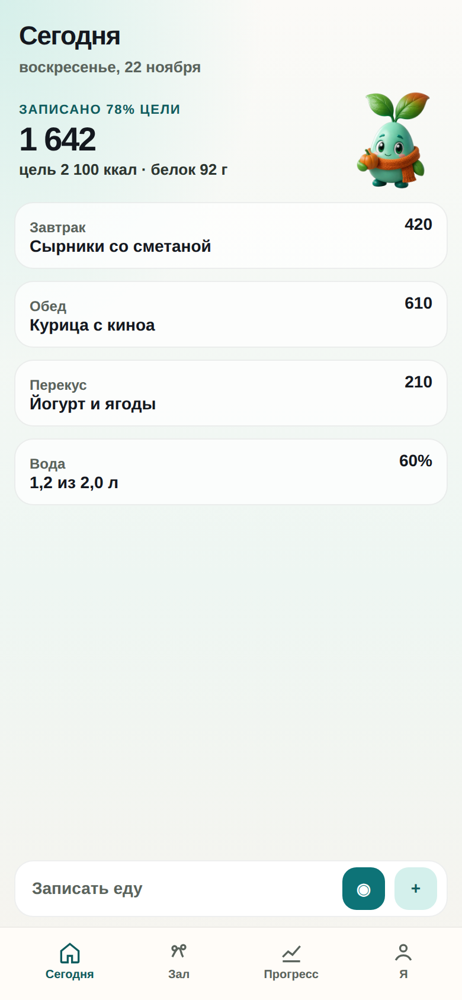

Та же дата, если прокрутить ленту. Полоска, «мета 2/5» и абзац правил.

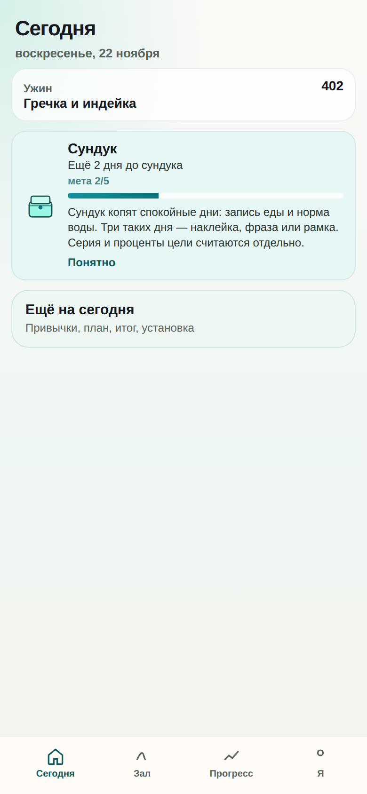

Когда шкала заполнена: кнопка «Открыть», «ещё в очереди», а квесты внутри «Ещё» говорят про «лёгкие дни».

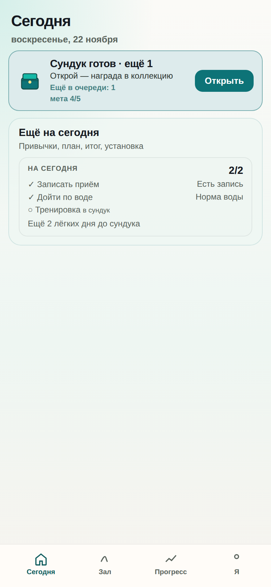

Зал: ссылка на рацион и абзац про зачёт. Открыть здесь нельзя.

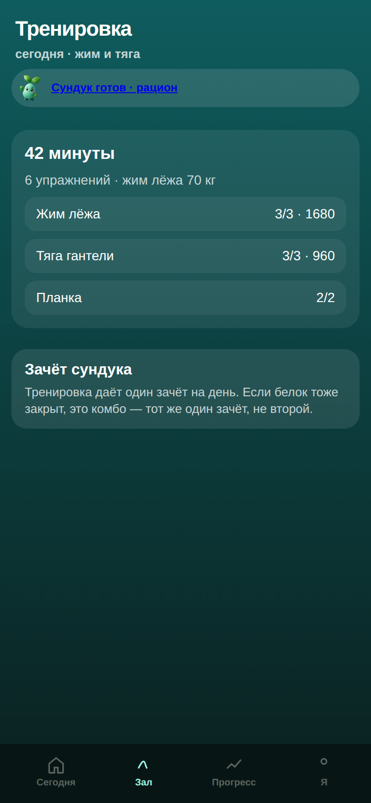

Коллекция в профиле: мелкие карточки и шесть разных причин открытия.

Церемония сейчас: ящик без груши.

Android: то же окно. Уведомление — про черновик на устройстве, не про сундук. Строка на карточке — «открытие в очереди».

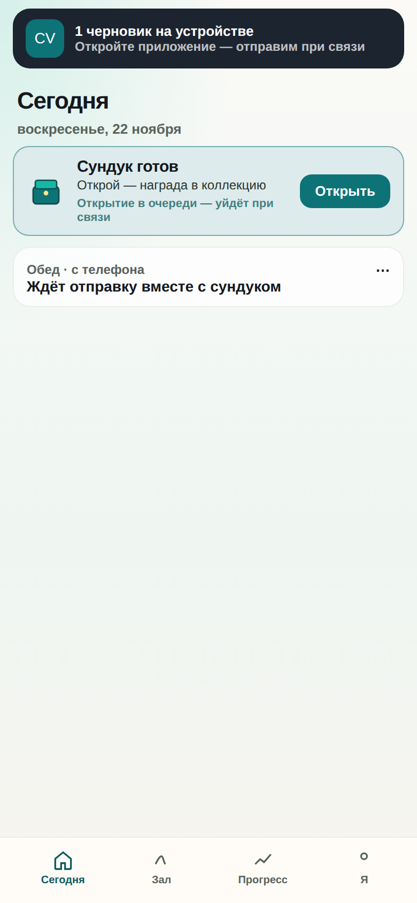

## Три варианта

### А. Две шкалы

Отдельная шкала «Тарелка» (три записи еды) и отдельная «Зал» (две настоящие тренировки). Два разных сундука.

Плюс: сразу видно, зачем идти в зал, даже если дневник уже ведётся. Плюс: правило каждой шкалы короткое.

Минус: на «Сегодня» две полоски рядом с калориями. Минус: кто не ходит в зал, постоянно видит пустую шкалу. Минус: снова два сундука и снова вопрос, какой открывать.

### Б. Живой день — этот и стоит делать

Одна шкала из трёх листьев на карточке груши, в первом экране «Сегодня».

Живой день — один на календарные сутки. Он есть, если есть тарелка или зал. Тарелка — хотя бы одна запись от 80 ккал, которая осталась в дневнике. Зал — завершённая тренировка с рабочим подходом, не разминка. Три живых дня — сундук. Если в один день есть и еда, и зал, искра всё равно одна, но этот день помечается комбо: ближайший сундук на ступень реже.

Вода, процент калорий и настроение сундук не двигают. Они остаются в трекере, в герое дня и в значках.

Плюс: одно предложение, которое можно прочитать на карточке. Плюс: и дневник, и зал двигают одну цель, пропуск дня шкалу не обнуляет. Плюс: комбо — причина сходить в зал в день, когда еда уже записана, без второй полоски.

Минус: в зал по-прежнему не обязаны. Кто ведёт только дневник, сундуки получает. Зал повышает редкость, а не открывает отдельную коробку. Это сознательный обмен: одна понятная шкала важнее второй обязательной.

### В. Только серия

Сундук за три живых дня подряд. Пропуск обнуляет.

Плюс: огонь серии очень заметен, груша «просит не бросать».

Минус: тон приложения — без штрафа и без давления. Обрыв серии бьёт больнее пустой шкалы, а серия дней уже есть в значках. Для человека, который и так заходит каждый день, серия ничего не объясняет: непонятно останется «что именно я сделал».

Дальше расписан вариант Б.

## Правило, которое видит человек

Верх «Сегодня» — та же карточка, что в приложении: «Осталось N из M ккал», полоска калорий, белки, жиры, углеводы, чип воды «Стакан». Сундук под ней полоской около 76 px: три листка, мини-сундук и одна фраза. Нажатие открывает шторку. Когда третий листок есть, полоска светится.

Груша пишет коротко, как в мессенджере. На экране нет слов «искра», «комбо», «живой день», «кладовая», «поинтереснее», «с камушком», «хорошие дни». Редкости: обычный, редкий, золотой. Порог 80 ккал только мелким шрифтом в правилах.

> Вчера зал, позавчера завтрак — остался сегодняшний листок.

Варианты, из которых на макете взят первый, если не сказано иначе:

| Место | На макете | Ещё варианты |
| --- | --- | --- |
| 0 из 3, полоска | Пока пусто. Завтрак или зал — и первый листок. | Три места пустые. Начни с еды. / Сундук далеко, один завтрак уже сдвинет. |
| 1 из 3 | В пятницу был завтрак. Ещё два дня. | Один листок есть, два впереди. / Пятница зачтена. Суббота и сегодня ещё нет. |
| 2 из 3 | Вчера зал, позавчера завтрак — остался сегодняшний листок. | Два листка есть. Сегодняшний ещё нет. / Пт завтрак, сб зал. Сегодня добьёшь — сундук. |
| Сундук готов | Три дня есть. Можно открывать. | Ну всё, открываем. / Пт, сб и сегодня на месте. Жми. |
| Шторка, оба дела | Сделаешь и то и другое — в сундуке будет редкая вещь. | И еда, и зал сегодня — редкая вещь, не обычная. / Зал сверху к еде делает вещь редкой. |
| Утро, пуш | Ещё один день — и сундук твой. | Остался один листок, сегодня. / Завтрак или зал — и можно открывать. |
| Возврат | Листки на месте. Ничего не пропало. Рада, что ты здесь. | Я ничего не стёрла. Заходи. / Три дня тишины, листки целы. |
| Редкий сундук | Редкий. Если в один день и еда, и зал. | Не деревянный: внутри редкая вещь. / Камень светится — это редкий. |

Если день пустой, она говорит: «Давай начнём». Если листок один: «Первый листок на месте. Ещё два таких дня — и сундук твой». Если три: «Сундук твой. Откроем?» Если сегодня и еда, и зал: «Сделаешь и то и другое — сундук будет поинтереснее».

Вода и проценты цели она называет прямо: «тут ни при чём».

Пороги живут мелким шрифтом в правилах и на втором экране знакомства, не в главной фразе. Еда от 80 ккал. Тренировка — от 5 повторов, или 5 минут, или полкилометра, и это не разминка.

Четыре состояния карточки:

| Листки | Что говорит груша |
| --- | --- |
| 0 из 3 | «Давай начнём. Запиши, что съел, или сходи в зал — появится первый листок.» |
| 1 из 3 | «Первый листок на месте. Ещё два таких дня — и сундук твой.» |
| 2 из 3 | «Ещё один день — и сундук твой.» |
| 3 из 3 | «Сундук твой. Откроем?» |

Имена сундуков для человека: простой деревянный, поинтереснее (с камушком), золотой. Слова «редкий» и «праздничный» остаются в таблице шансов для разработки, на экран не выносятся.

### Было → стало

| Было | Стало |
| --- | --- |
| Тарелка или зал. Три живых дня — сундук. | Ещё один день — и сундук твой. |
| Запись еды от 80 ккал или тренировка с рабочим подходом. | Запиши, что съел, или сходи в зал. Порог 80 ккал — мелким шрифтом в правилах. |
| Остался один лист. | Ещё один день — и сундук твой. |
| Если сделать и еду, и зал, этот сундук станет редким: лак и светящийся камень. | Сделаешь и то и другое — сундук будет поинтереснее. |
| Неделя · 4 из 5 живых дней. Полка в воскресенье. | На неделе уже четыре хороших дня. Ещё один — подарок. |
| Сундук готов. Откроется лаковый, не деревянный. | Сундук твой. Сегодня ты и поел, и был в зале. |
| Редкая · комбо. Нормы не меняются. | Поинтереснее. Калории это не меняет. Надень. |
| Лак и янтарь. | С камушком. |
| Праздничный. Золото сезона. | Золотой. Для особых дней. |
| Листья на месте. Ничего не сгорело. | Листки на месте. Ничего не пропало. Рада, что ты здесь. |
| Один лист до сундука. Тарелка или зал. | Ещё один день — и сундук твой. |
| Пропуск ничего не стирает. Купить искру нельзя. | Пропустил — ничего не сгорает. Купить день нельзя. |
| Финал открывается на 8 уникальных вещах. | Для золотого сундука нужно восемь вещиц и четыре недели. |

## Что взяли у других

Цифры ниже только те, что написаны в источниках. Где источника с цифрой нет, цифры нет.

**Duolingo.** Серия — дни подряд с уроком. Заморозка покупается заранее и бережёт один пропущенный день; в справке сказано, что после потери серии её можно чинить за камни, а заморозку надо купить до пропуска ([справка Duolingo](https://www.duolingo.com/help/what-is-a-streak)). В блоге Duolingo пишет, что разрешение держать две заморозки сразу подняло долю активных учеников на 0,38% в день, и ссылается на исследование Пенсильванского университета и UCLA: небольшая слабина в цели мотивирует сильнее жёсткого правила ([блог, 31 января 2022](https://blog.duolingo.com/how-duolingo-streak-builds-habit/)). В том же блоге про защиту серий от сбоев сайта: внутренний механизм сохранил больше 2 миллионов серий ([блог, 1 ноября 2021](https://blog.duolingo.com/protecting-streaks-from-site-issues/)). Людей бесит, когда из сундуков и заданий пропадают камни и заморозки и остаются только множители опыта: на Reddit пишут, что утренние и вечерние сундуки помогали привычке «два раза в день», а теперь мотивации меньше ([тред, декабрь 2024](https://www.reddit.com/r/duolingo/comments/1h759rr/where_have_the_morning_and_evening_bonus_xp/)), и что камни были единственной причиной заходить ([тред, октябрь 2024](https://www.reddit.com/r/duolingo/comments/1fyik6x/cant_earn_gems_anymore/)). Берём: видимый прогресс «ещё чуть-чуть» и честное «пропуск не обнуляет». Не берём: валюту, лиги, платную заморозку и сундук, из которого внезапно пропадает привычная награда.

**Finch.** Питомец, одежда и мебель за дела, без стыда за несделанное. Engadget описывает камни радуги за цели и одежду птицы и прямо говорит: приложение не ругает, если список не закрыт ([Engadget](https://www.engadget.com/apps/this-self-care-virtual-pet-is-helping-me-get-my-act-together-160027169.html)). Slate называет это «мягким родительством» против колкого Duo и приводит цену Plus: 9,99 доллара в месяц или 69,99 в год. Там же автор устаёт от ленты уведомлений после каждой галочки и от того, что магазин тянет в приложение дольше, чем само дело ([Slate, сентябрь 2026](https://slate.com/technology/2026/09/finch-app-self-care-wellness-review.html)). На Reddit тред на 865 голосов просит забирать пачку наград одной кнопкой: девятнадцать окон за 20 камней не ощущаются наградой ([r/finch, май 2025](https://www.reddit.com/r/finch/comments/1klm0z7/anxiety_over_all_the_alerts_suggestion_submitted/)). Берём: голос друга и одежду на груше. Не берём: магазин за монеты, пачку окон «забери награду» и пуши на каждый листок.

**Clash Royale и Brawl Stars.** Сундук узнаётся по материалу и звёздам, шансы опубликованы. У Supercell для Magic Lucky Chest стартовой редкостью в 1 звезду таблица такая: 31,64% остаться на 1 звезде, 43,04% на 2, 20,25% на 3, 4,06% на 4, 1,01% на 5 ([справка Clash Royale](https://support.clashroyale.com/hc/en-us/articles/49484957072539-Lucky-Chests-Boxes)). Сезонный сундук в разборе обновления Q3 2025 имеет отдельную шкалу «открыл N сундуков — гарантированная вещь», чтобы редкость не была только лотереей ([RoyaleAPI](https://royaleapi.com/blog/clash-royale-2025-q3-update?lang=en)). Игроки просят короче анимацию: «4 секунды сто раз подряд» ([r/ClashRoyale, февраль 2026](https://www.reddit.com/r/ClashRoyale/comments/1reu0rf/dear_supercell_please_cut_the_animations_for/)), то же про Starr Drop в Brawl Stars ([июнь 2026](https://www.reddit.com/r/Brawlstars/comments/1ueyse2/loot_animation_skips_should_have_been_in_this/), [март 2026](https://www.reddit.com/r/Brawlstars/comments/1rtf7dj/quality_of_life_improvement_for_star_drops/)). Разбор Starr Drop пишет, что редкость считается до ролика, а нажатия её не меняют; для обычных дропов скрытой гарантии автор не нашёл ([brawl.tube, 14 апреля 2026](https://brawl.tube/brawl-stars-starr-drops-complete-guide/)). Берём: три разных сундука на вид, опубликованные шансы и гарантию, которая не зависит от того, как быстро тыкаешь. Не берём: прокачку сундука тапами, очередь из десятков роликов и валюту за победы.

**Habitica.** Пропуск ежедневной задачи бьёт по здоровью, а на боссе — ещё и по друзьям ([обзор FOCO](https://www.tryfoco.com/habitica-review/)). Исследование Diefenbach и Müssig (2019) на 45 людях за две недели: контрпродуктивный эффект был у всех участников в какой-то мере, и он связан с ощущением, что награда несправедлива ([International Journal of Human-Computer Studies](https://dl.acm.org/doi/10.1016/j.ijhcs.2018.09.004)). На Reddit люди уходят из‑за серий и красных задач, которые «не возвращаются» ([r/habitica, май 2026](https://www.reddit.com/r/habitica/comments/1t59nas/what_made_people_quit_habitica/)). Берём: вещи на персонажа. Не берём: урон, смерть персонажа и стыд за пропуск.

**Apple Fitness и Fitbit.** Три кольца видны сразу, награды вроде Perfect Week и самой длинной серии Move требуют закрывать кольцо день за днём ([The Verge, 10 ноября 2021](https://www.theverge.com/22774263/wearables-smartwatches-apple-watch-fitness-trackers-fitbit-streaks-recovery)). Автор Verge описывает, как берегла серию в 90 дней и довела до шинсплинта. Android Authority пишет, что день болезни или травмы в Apple Fitness срывает много наград сразу, а недельная цель (как Heart Points у Google Fit) спокойнее переносит отдых ([Android Authority, 21 мая 2022](https://www.androidauthority.com/fitbit-apple-fitness-rest-days-3163136/)). Берём: три видимых шага, как кольца, и запас пустых дней на неделе. Не берём: «идеальную неделю без единого пропуска» и серию, которую стыдно оборвать из‑за болезни.

**Strava.** Значки висят над профилем. Человек с 632 трофеями пишет, что после челленджа они ничего не значат ([сообщество Strava, 2022](https://communityhub.strava.com/archived-strava-features-chat-5/does-anyone-actually-use-the-trophy-case-1117)). Ответ сотрудника: кому‑то значок — цель, кому‑то хочется его убрать. Позже просят оставить на виду несколько своих, а не стену спонсорских челленджей ([r/Strava, сентябрь 2025](https://www.reddit.com/r/Strava/comments/1n84zk3/trophies_could_be_so_much_better/)). Берём: маленькую полку сезона и одну надетую вещь на груше. Не берём: стену из сотен бейджей и челленджи ради скидки.

**MyFitnessPal, Yazio, FatSecret.** В MyFitnessPal люди спорят с поддержкой из‑за двух разных серий: вход в приложение и дни с едой. Один описывает 4992 дня входа и пищевую серию, которая прыгала с 4089 на 2337 без пустых дней ([форум MFP](https://community.myfitnesspal.com/en/discussion/10914432/i-see-they-ve-added-a-streak-count-on-the-food-log-tab-mine-is-incorrect-anyone-else)). В Yazio серия и квесты обязательны: после записи еды всплывают сводка, серия и задание, выключить нельзя, люди пишут, что проще закрыть приложение ([r/yazio, октябрь 2024](https://www.reddit.com/r/yazio/comments/1fttthx/streaks_are_annoying/)). FatSecret даёт выключить показ серии в дневнике и отдельно уведомления о сериях и значках ([справка: скрыть серию](https://www.fatsecret.com/fatsecret-app-help/badges-and-streaks/remove-streak-display-from-diary), [справка: уведомления](https://www.fatsecret.com/fatsecret-app-help/badges-and-streaks/manage-streak-and-badge-notifications)). Берём: одно и то же число листков везде и отдельный выключатель пушей про сундук. Не берём: серию «просто открыл приложение», всплывающие окна поверх записи еды и квест «добери клетчатку», который нельзя пропустить.

**Forest.** Дерево растёт, пока не уходишь из приложения, и засыхает, если ушёл. Mashable: таймер от 10 до 120 минут, шаг 5 минут, 10 секунд на отмену после посадки ([Mashable](https://me.mashable.com/culture/4595/forest-is-a-useful-app-that-helps-you-go-phone-free-by-inspiring-you-to-plant-trees)). Людей злит отсутствие паузы и то, что 4 минуты сверх плана считаются мёртвым деревом, а час учёбы выглядит как провал из‑за одного пня ([r/forestapp, ноябрь 2025](https://www.reddit.com/r/forestapp/comments/1oxhwss/annoyed_at_forest/)). Zeit ещё в 2015 описывает двойную вину: и сорвался, и видишь пень ([Die Zeit, 12 июня 2015](https://www.zeit.de/digital/mobil/2015-06/forest-app-kritik-fokussiertes-arbeiten)). Берём: живой росток на экране дня, который хочется не бросить. Не берём: засохший день, пень на календаре и наказание за короткую тренировку.

### Что из этого поменяли в механике

Запись еды никогда не перекрывается сундуком. Карточка на «Сегодня» обновляется на месте. Так просят люди, которые в Yazio закрывают приложение, лишь бы не кликать сводку, серию и квест.

Редкость считается в момент, когда сундук стал готов, до ролика. Тапы по экрану её не меняют. Так устроен Starr Drop в разборе brawl.tube, и это честнее, чем «прокачай сундук тремя нажатиями» у Lucky Chest.

Первый сундук за заход играется целиком. Если их несколько, на ролике есть «Хватит, покажи подарок»: сразу карточка вещи. Это ответ на треды Clash Royale и Brawl Stars про пачку одинаковых анимаций. В прототипе кнопка уже есть.

Пустые дни недели подписаны «отдых», не дыркой и не пнём. Два таких дня за неделю — норма, как запас у недельной цели, о котором пишет Android Authority в отличие от Perfect Week. Серия «идеальная неделя без единого пропуска» не заводится.

Пуши про сундук выключаются отдельно, как значки у FatSecret. Карточку можно свернуть до груши, число листков при этом то же. Второй счётчик «просто зашёл в приложение» не заводим: на форуме MyFitnessPal два разных числа ломают доверие.

Одежда остаётся на груше, без магазина и без пачки окон «забери». Это вывод из Slate и треда Finch на 865 голосов.

Числа шансов, три листа, пять дней недели, восемь вещиц и четыре недели сезона не менялись. Меняется только то, как это сказано и что не встаёт поперёк записи еды.

## Три слоя: завтра, неделя, месяц

Дневной слой отвечает на «зачем открыть приложение сегодня». Три листа не сбрасываются пропуском. На 2 из 3 карточка становится состоянием «почти»: видно, какое действие зажжёт третий лист, и какого цвета будет сундук.

Недельный слой отвечает на «зачем вернуться до воскресенья». Неделя считается с понедельника по воскресенье в часовом поясе человека. Пять живых дней дают отдельный сундук полки. Два тихих дня уже заложены в семёрку: это не штраф и не заморозка, просто запас. В понедельник счётчик недели начинается с нуля. Листья дневного сундука при этом остаются как были.

Сезонный слой отвечает на «зачем продолжать месяц». Сезон совпадает с костюмом груши: осень сентябрь–ноябрь, зима декабрь–февраль, весна март–май, лето июнь–август. Праздничные скины (новый год, хэллоуин и остальные из `public/mascot`) меняют грушу, но не заводят второй сундучный сезон. На полке 12 вещей сезона. Финал — отдельный золотой сундук, его нет в обычном розыгрыше. Он открывается, когда собраны 8 уникальных вещей сезона и 4 недельных сундука. Если к последнему дню сезона вещи уже есть (8 или больше), а недель только меньше четырёх, финал всё равно выдаётся при 24 живых днях за сезон: отпуск не должен съесть награду. Меньше восьми вещей — финал этого сезона закрывается и в следующий не переносится. Уже полученные вещи остаются навсегда.

| Слой | Что копит | Что даёт | Что будет, если пропустить |
| --- | --- | --- | --- |
| День | 1 искра на местную дату, 3 искры = сундук | Обычный или, с комбо, более редкий сундук | Листья остаются |
| Неделя пн–вс | 5 живых дней | Сундук полки, минимум редкий | До двух тихих дней норма. Третий тихий день просто оставляет неделю без сундука. В понедельник счёт новый |
| Сезон ~3 месяца | Вещи полки и недельные сундуки | Золотой финал | Вещи не сгорают. Финал не переезжает в следующий сезон |

## Числа: шансы, комбо, гарантия

Одна искра на дату. Еда и зал в один день вторую искру не дают. Этот день помечается комбо.

Комбо применяется после базового броска и поднимает итог на одну ступень: обычный становится редким, редкий — праздничным, праздничный остаётся праздничным.

База дневного сундука и то, что видит человек после комбо:

| | Обычный | Редкий | Праздничный |
| --- | --- | --- | --- |
| День без комбо | 70% | 25% | 5% |
| Тот же бросок после комбо | 0% | 70% | 30% |

70% обычных бросков становятся редкими, 25% редких становятся праздничными, 5% праздничных такими и остаются. Поэтому комбо читается одной фразой: «сундук на ступень выше», и на карточке «почти» уже можно показать лаковый сундук, а не деревянный.

Недельный сундук в обычную неделю: редкий 80%, праздничный 20%, обычный 0%. Если на неделе два или больше комбо-дней, недельный сундук праздничный всегда.

Финал сезона всегда праздничный и в эту таблицу не входит.

Гарантия считается по уже готовому итогу, после комбо:

- Четыре сундука подряд (дневные и недельные вместе) с итогом «обычный» быть не могут. Четвёртый станет минимум редким, счётчик обычных сбрасывается.
- Двенадцать сундуков подряд без праздничного быть не могут. Двенадцатый праздничный, счётчик сбрасывается.
- Комбо, которое само подняло ступень, гарантию закрывает. Отдельной «удачной» покупки нет.

Порядок на сервере: базовый вес → сдвиг комбо → если гарантия требует выше, поднять ещё → записать итог и оба счётчика.

Дневной сундук с вероятностью 60% берёт вещь текущей полки сезона (сначала ту, которой ещё нет), с вероятностью 40% — постоянный гардероб: рамка, тема, вещь вне сезона. Недельный сундук всегда с полки сезона. Финал в эти 60% не попадает.

## Пропуск, возврат, запасной лист

Шкалу из трёх листьев пропуск не обнуляет и не разъедает. Отдельная «заморозка листьев» не нужна: сгорать нечему. Заморозка пищевой серии в значках остаётся своей механикой и сундук не двигает.

После трёх календарных дней без искры следующий заход встречает груша и текст «листья на месте». Это не подарок и не сундук сверху.

Запасной лист — один, не копится. Он появляется, когда открыт недельный сундук, и только если в кармане пусто. Его можно потратить на вчера, если вчера искры не было. На сегодня, на будущее и на день, где искра уже есть, он не ставится. Это обычная искра, не комбо: лист не выдумывает тренировку. Купить его нельзя.

## Когда что говорим

Не больше одного пуша про сундук в сутки. В тихие часы, которые человек уже задал в напоминаниях, молчим. Если тихие часы не заданы — молчим с 22:00 до 8:00.

| Момент | Где | Текст |
| --- | --- | --- |
| Первый заход после включения | Два экрана в приложении | Правило дня, недели и сезона. Пропуск ничего не стирает |
| Утро, на шкале 2 из 3, сегодня ещё пустой | Пуш, если пушей ещё не было | «Один лист до сундука. Тарелка или зал.» |
| Человек только что записал еду, зала нет, это был третий лист или шаг к комбо | Строка в приложении, не пуш | «Лист зажёгся. Зал сегодня сделает сундук редким.» |
| Третий лист зажёгся | Карточка с кнопкой «Открыть сундук» | Без отдельного пуша: человек уже здесь |
| Вечер около 19:30, день всё ещё пустой и листьев 2 из 3 | Пуш, если утренний не ушёл | «Сундук ещё можно открыть сегодня.» |
| Воскресенье, на неделе 4 из 5 | Этот пуш вместо вечернего | «Ещё один живой день — недельная полка.» |
| Три тихих дня | Один пуш на возвращение вместо упрёка | «Листья на месте. Ничего не сгорело.» |
| Финал сезона готов | Только в приложении, на полке | «Финал осени можно открыть.» |

## Метрики и проверка

Смотреть на людях, которые уже пользуются дневником, не на установках ради сундука.

- Удержание D1, D7, D30 до и после включения, по неделям.
- Живые дни на человека за 7 дней. Это главная метрика карточки.
- Доля сундуков, открытых в течение 24 часов после того, как они стали готовы. Если копят и не открывают, церемония не сработала.
- Доля живых дней, которые стали комбо.
- Доля недель с сундуком полки среди тех, кто в продукте дольше 7 дней.
- Доля людей, дошедших до финала, среди тех, у кого сезон был открыт хотя бы 30 дней.
- Доля пушей про сундук, после которых в тот же день появляется искра, и доля отключивших напоминания.

Ограничители, чтобы яркость не породила мусор: удаления записей в первые 15 минут, тренировки ниже порога усилия, всплеск пустых строк около 80 ккал.

Две экономики рядом лучше не держать: сезонная полка у «старого» плеча будет дырявой, а потом её всё равно придётся мигрировать. Поэтому не режем редкость и не прячем правило от части людей. Проверяем три узкие вещи, липко по идентификатору пользователя, пополам:

1. Карточка «сегодня осталось вот это» против короткого «ещё один день». Смотрим, как часто 2 из 3 становятся 3 из 3 в тот же день.
2. Превью редкого сундука на карточке против карточки без сундука. Смотрим долю комбо. Рядом — не выросла ли доля тренировок ниже порога.
3. Вечерний пуш на 2 из 3 против тишины, только у тех, кто и так разрешил напоминания. Смотрим искру в тот же день и отключения пушей.

Шансы, комбо и «пропуск ничего не стирает» в эти проверки не кладём.

## Защита от пустых записей

Десять приёмов и три тренировки в одну дату дают одну искру. Накрутка количеством не работает.

Тарелка — запись от 80 ккал, которая всё ещё лежит в дневнике в момент зачёта. Зачёт ставится через 15 минут после события или при следующем открытии приложения, если 15 минут уже прошли. Удалили приём раньше — листа нет. Фото не требуется.

Зал — завершённая тренировка, не разминка, и порог усилия: от 5 повторов, или от 5 минут, или от 0,5 км. Если есть и старт, и конец, между ними не меньше 4 минут.

Вчера ещё можно дописать, если время приёма или конец тренировки попадает на вчера. Дни старше вчера шкалу не двигают. Запасной лист подчиняется тому же окну и не создаёт комбо.

Офлайн-очередь остаётся. Сервер при разборе черновика проверяет те же условия и не верит клиенту, что сундук уже заработан и какой он редкости. Повтор ключа ничего не создаёт.

Настроение, доля калорий и норма воды искру не дают.

## Что сделать с уже накопленным

Ничего не удалять. `UserReward`, надетые рамка, наклейка и фраза, значки и челленджи остаются. Они входят в постоянный гардероб. В сезонную полку задним числом их не записываем: осень начинается с нуля вещей сезона, гардероб при этом уже надет.

Перенос дневной шкалы считается по уникальным датам, не по сырому числу строк. В дату входят `quest-day:ДАТА` и `gym-chest:ДАТА:…`. Строки `quest-day-boost:` не входят. Уже открытые `quest-chest:N` остаются открытыми. Неоткрытые — целая часть числа дат, делённая на 3, минус уже открытые — становятся очередью «прежние сундуки». Их открывают новой церемонией. В первой сессии показываем не больше трёх, остальные лежат на полке, чтобы миграция не превратилась в фейерверк. Остаток дат по модулю 3 — это уже заполненные листья новой шкалы.

Первый сундук из этой очереди открывается минимум редким: человек не должен почувствовать, что переделка обеднила то, что он уже заработал. Дальше очередь идёт по новой таблице. Сверху к числу неоткрытых ничего не добавляем.

Серия, спокойная неделя, челлендж и приглашение, которые уже висят неоткрытыми, один раз попадают в ту же очередь и в тот же потолок трёх за сессию. Новые сундуки из этих источников больше не копятся. Сами серии, челленджи и значки остаются.

Мета, которая набралась и не выдана, дописывается в гардероб без второго полноэкранного праздника. Строка «мета 2/5» уходит.

Счётчики гарантии и запасной лист у перенесённых людей начинаются с нуля. Сезонный финал тоже с нуля.

Пока старый клиент в офлайне не дослал «отметить день», сервер проводит запрос по новым правилам и не ставит одновременно старый зачёт и новую искру.

## Как это выглядит

Верх экрана тот же, что карточка дня в приложении: остаток калорий, полоска, белки, жиры, углеводы, вода. Под ней полоска сундука высотой 76 px, дальше лента приёмов. Нажатие на полоску открывает шторку.

Ноль листков. Калории и БЖУ на месте.

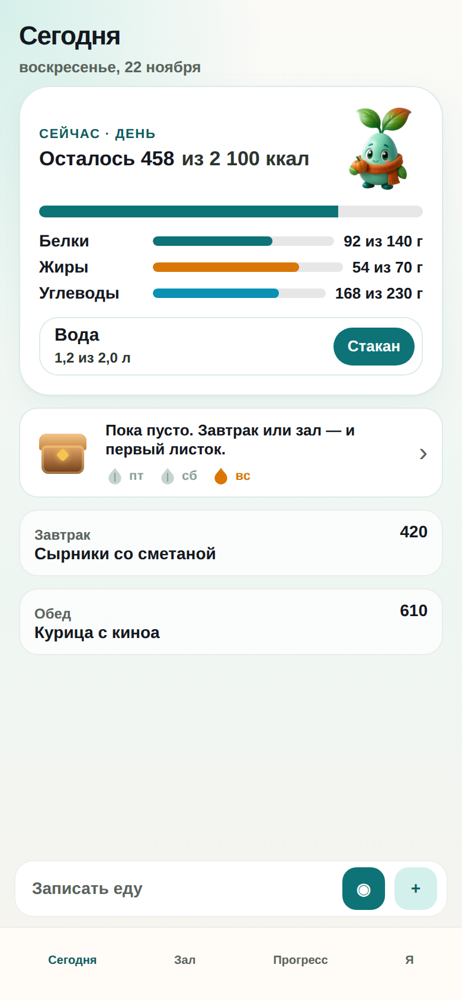

Один листок.

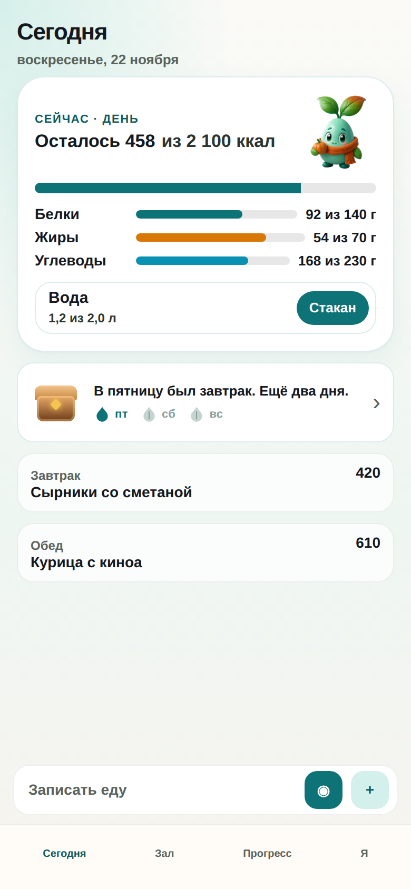

Два из трёх: «Вчера зал, позавчера завтрак — остался сегодняшний листок».

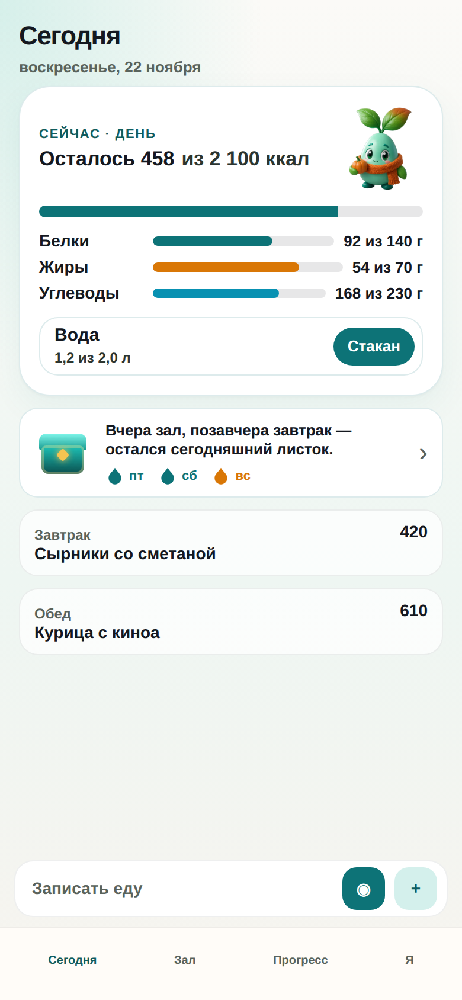

Сундук готов, полоска светится.

Шторка поверх того же экрана.

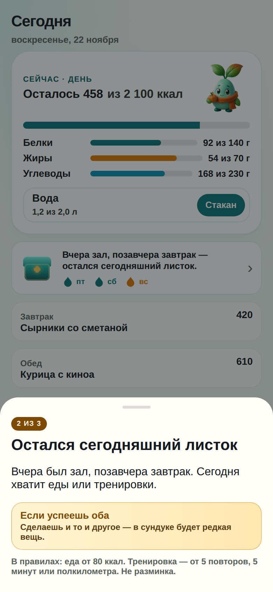

Для сравнения — тот же верх «Сегодня», а сундук по-прежнему под лентой приёмов, как в приложении сейчас.

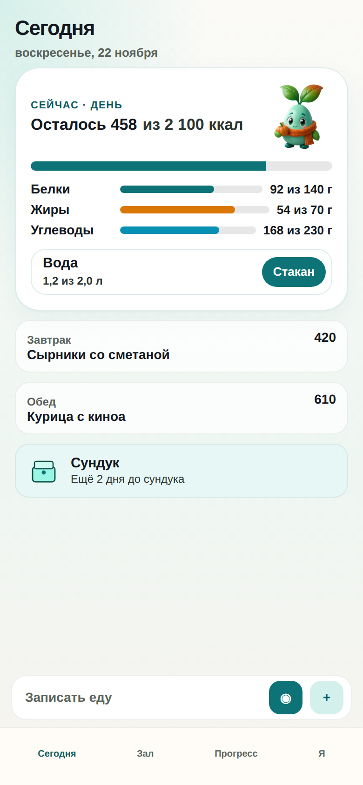

Три материала одного сундука. Обычный — дерево и латунь. Редкий — бирюзовый лак и янтарный камень. Праздничный — золото, камень теплее, крышка открыта.

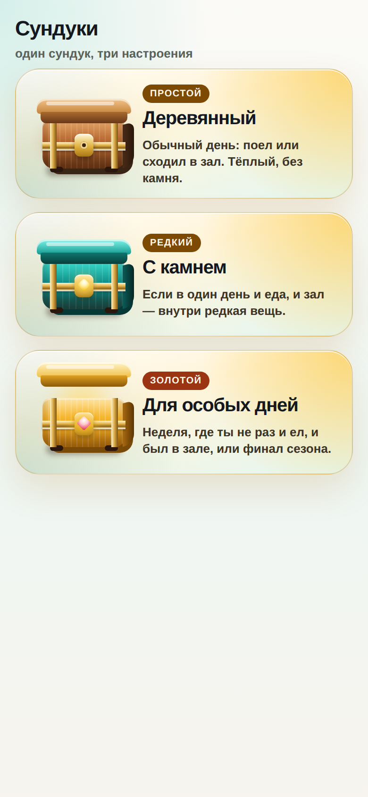

Неделя: 4 из 5, два тихих дня уже стоят пустыми, воскресенье подсвечено.

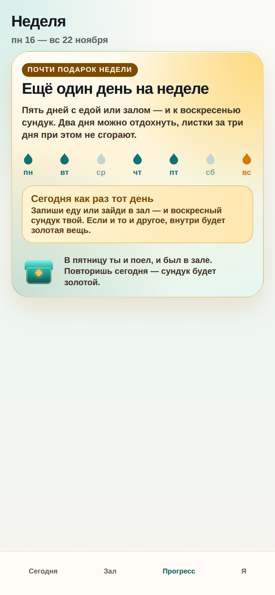

Сезон и полка. Неполученное — тёмный силуэт. Финал обведён золотом и не лежит в общем розыгрыше.

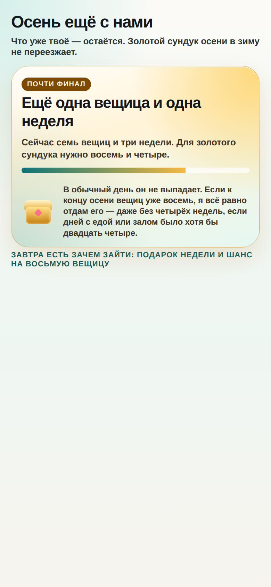

### Открытие

Сцена темнее прежней, с тёплым ядром. Груша из `public/mascot`. Сундук объёмный: боковая грань, металлические ленты, замок, камень. Редкость видна материалом, не только подписью.

1. Замер. Груша над закрытым редким сундуком. Лента латунная, камень уже тёплый, вокруг пара листьев.
2. Щель. Сундук качнулся, крышка привстала, из щели янтарный свет.
3. Вспышка. Крышка поднята над ящиком, кольцо «редкий», листья-конфетти.
4. Предмет. Из света выходит карточка «Золотой лист». Груша в осеннем шарфе рядом.

Дальше экран награды: надеть или положить на полку. Если праздники приглушены, тряска не играет, но карточка награды остаётся.

Живой прототип на CSS и JS, его можно открыть в браузере: `docs/chests-redesign/concept/open-play.html`. Параметр `?t=` останавливает ролик на миллисекунде, с него сняты кадры превью.

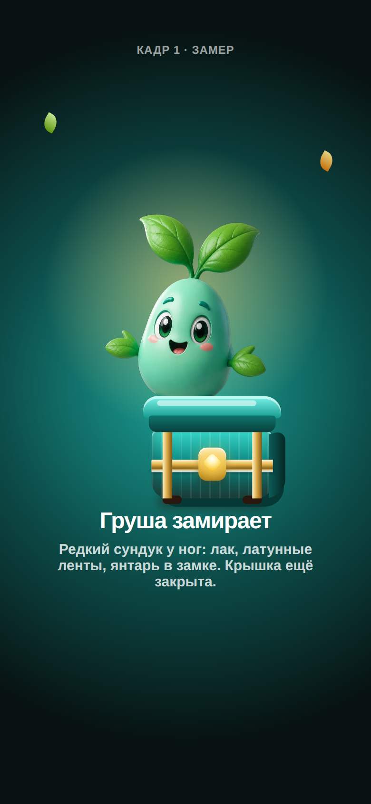

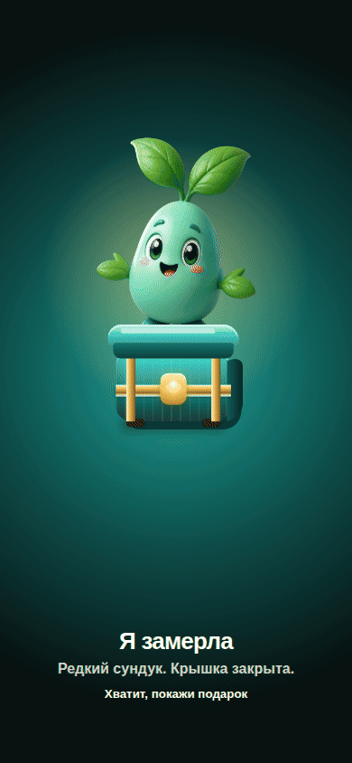

Ролик той же сцены: [open-play.mp4](chests-redesign/concept/open-play.mp4).

### Правила и напоминания

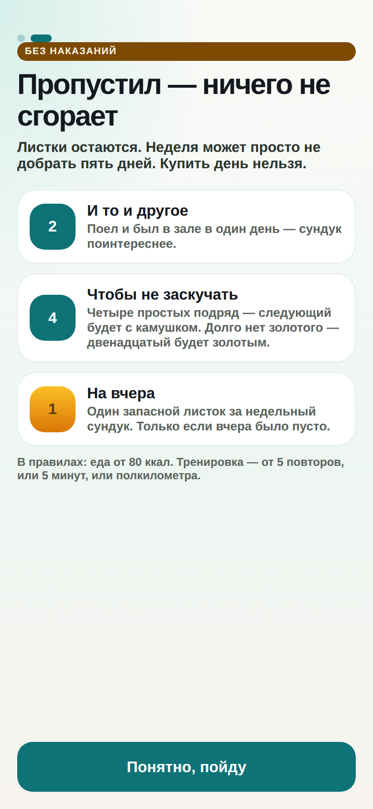

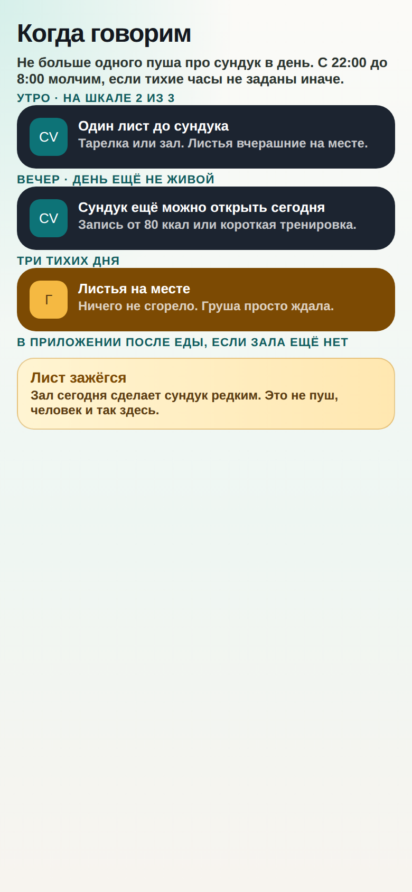

## Этапы, когда дойдёт до кода

Оценка ниже — это объём правки, не срок в днях. Этот документ продукт не меняет.

1. День и карточка «почти». Средний объём. Одно правило, одна искра на дату, пометка комбо, задержка зачёта на 15 минут, карточка над лентой. На первом шаге хватает строк `UserReward` с новыми ключами `spark:ДАТА`, без новой таблицы. Файлы: `src/lib/daily-quests.ts`, `src/lib/chest-eligibility.ts`, `src/lib/chest-progress.ts`, `src/lib/gym-rewards.ts`, `src/lib/gym-reward-grant.ts`, `src/lib/moment-hero.ts`, `src/components/ChestDock.tsx`, `src/components/MomentHeroCard.tsx`, `src/app/ration/page.tsx`, `src/app/globals.css`, `src/app/api/rewards/route.ts` и тесты этих модулей.
2. Церемония. Средний объём. Объёмный сундук трёх редкостей, четыре такта, вспышка и листья. Файлы: `src/components/ChestOpenStage.tsx`, `src/components/FullscreenCelebration.tsx`, `src/components/LootRevealCard.tsx`, блок `.fs-chest-*` в `src/app/globals.css`. Позы груши уже в `public/mascot`. Ориентир анимации — `docs/chests-redesign/concept/open-play.html`.
3. Неделя, сезон, полка, шансы. Крупный объём, самый широкий. Недельный ключ, 12 вещей сезона, финал, два счётчика гарантии, запасной лист. Здесь уже нужны поля у пользователя (счётчики, держит ли он лист) — это отдельная схема, не этот черновик. Файлы: `src/lib/rewards.ts`, `src/components/RewardsPanel.tsx`, новый экран полки рядом с профилем, `src/lib/reward-grant.ts`.
4. Слова и пуши. Средний объём. Два экрана онбординга, строки после еды, один пуш в день с учётом тихих часов. Файлы напоминаний рядом с `src/lib/push` и экраном профиля, без новой экономики.
5. Перенос. Средний объём, осторожный. Скрипт в `scripts/`, старые строки не удалять, очередь «прежние» с потолком трёх за сессию, первый из них минимум редкий.
6. События и три проверки. Небольшой объём относительно полки: события «искра», «сундук готов», «сундук открыт», «комбо», «пуш», и липкое плечо по идентификатору. Шансы не делим.
7. Android. Небольшой объём. Отдельного экрана в Java нет. Поменять текст очереди, если тело запроса сменится (`src/lib/rewards-draft-queue.ts`, `src/lib/chest-client.ts`), и не смешивать «сундук готов» с числом черновиков на иконке (`src/lib/capacitor-queue-badge.ts`).

Значки зала и комбо (`src/lib/badges.ts`) остаются. Меняется только то, что тренировка больше не второй тик той же дневной шкалы: она либо зажигает единственную искру дня, либо помечает этот день комбо.
